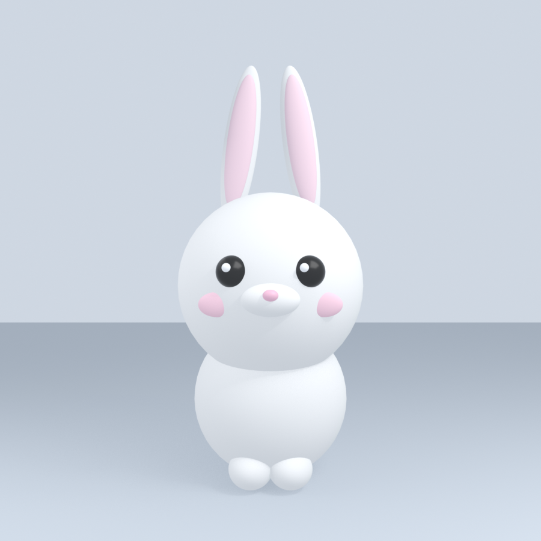
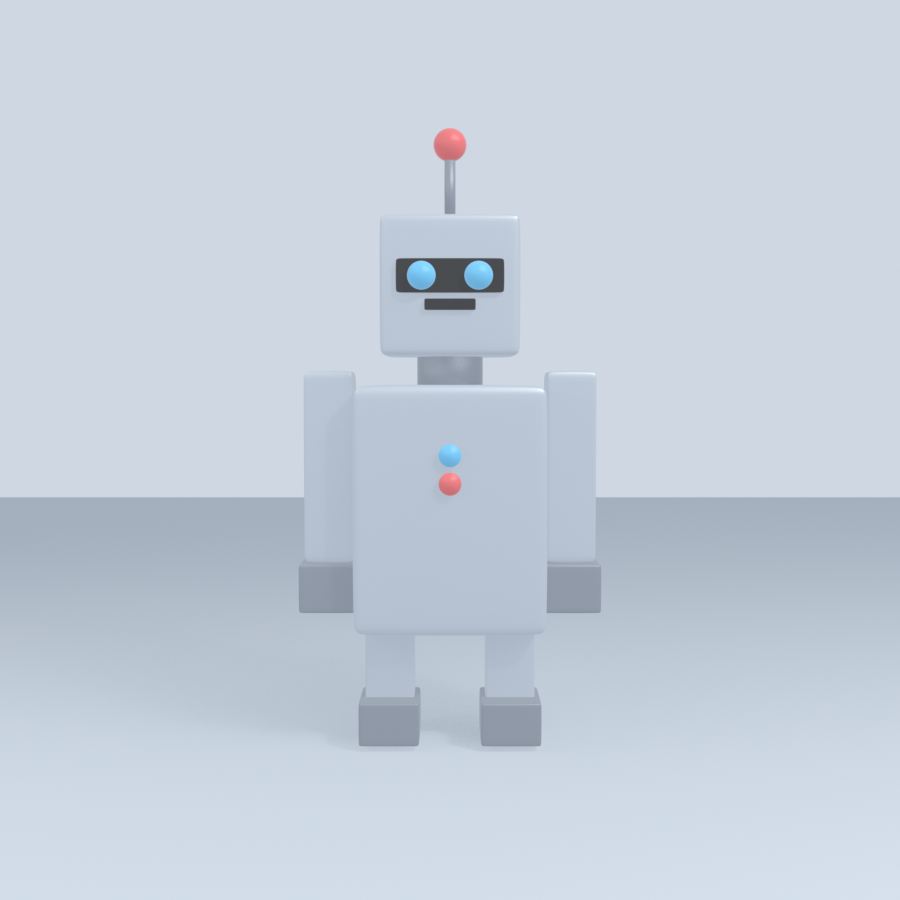

# VR-Models

Коллекция 3D-персонажей, собранных из примитивов **Blender** средствами **Python (bpy)**.
Каждый персонаж — это один самодостаточный скрипт: он очищает сцену, строит модель из
сфер, кубов, цилиндров и конусов, настраивает свет и камеру и сохраняет готовый рендер.

Модели low-poly и стилизованные — их удобно использовать как заглушки (placeholders)
и учебные ассеты для VR/AR-сцен, прототипов и игровых движков.

---

## Содержимое

### 🐰 Кролик — `rabbit.py`



| Параметр | Значение |
|---|---|
| Объектов в сцене | 17 |
| Примитивы | UV-сферы, эллипсоиды |
| Материалы | мех, розовый (уши, щёки, нос), чёрный (глаза), белый (блики) |
| Особенности | пропорции «чиби», большая голова, длинные уши с розовой внутренней частью, блики в глазах |

### 🤖 Робот — `robot.py`



| Параметр | Значение |
|---|---|
| Объектов в сцене | 19 |
| Примитивы | кубы (со скруглением), цилиндры, сферы |
| Материалы | светлый металл, тёмный металл, чёрный, голубой, красный |
| Особенности | антенна, панель глаз со светящимися линзами, кнопки на корпусе |

---

## Структура репозитория

```
VR-Models/
├── rabbit.py               # скрипт: кролик
├── Rabbit.png              # рендер кролика (900×900)
├── Rabbit_screenshot.png   # скриншот сцены в Blender
├── robot.py                # скрипт: робот
├── Robot.png               # рендер робота (900×900)
├── Robot_screenshot.png    # скриншот сцены в Blender
└── README.md
```

Все файлы PNG — изображения 900×900, полученные рендером в EEVEE.

---

## Как запустить

1. Откройте **Blender** (проверено на 5.2.3 LTS, подойдёт и 4.x).
2. Перейдите на вкладку **Scripting** → **New**.
3. Вставьте содержимое нужного скрипта (`rabbit.py` или `robot.py`).
4. Нажмите **Run Script** (или `Alt+P`).
5. Персонаж появится в 3D-вьюпорте, а картинка сохранится рядом со скриптом
   (при запуске из редактора — в домашнюю папку пользователя).

Скрипт можно запустить и из консоли, без открытия интерфейса:

```bash
blender -b --factory-startup -P rabbit.py
blender -b --factory-startup -P robot.py
```

---

## Технические детали

- **Сцена** очищается полностью (`clear_scene()`), поэтому скрипты можно запускать повторно.
- **Примитивы**: `primitive_uv_sphere_add`, `primitive_cube_add` (модификаторы Bevel + Subdivision),
  `primitive_cylinder_add`, `primitive_cone_add`.
- **Материалы**: ноды Principled BSDF (цвет, металличность, шероховатость).
- **Свет**: две Area-лампы (ключевая и заполняющая), мощность снижена, чтобы белые материалы
  не выгорали.
- **Камера**: объектив 50 мм, кадрирование по высоте персонажа.
- **Рендер**: EEVEE, 900×900, цветокоррекция `Standard` вместо AgX — так цвета чище.
- Масштаб: персонажи примерно 2.3–3.6 единицы в высоту, стоят на плоскости `Z = 0`.

---

## Идеи для развития

- экспорт в `.glb` / `.fbx` для VR-движков (Unity, Unreal, Godot);
- анимация (прыжок кролика, поворот головы робота);
- добавление новых персонажей по тому же шаблону.
