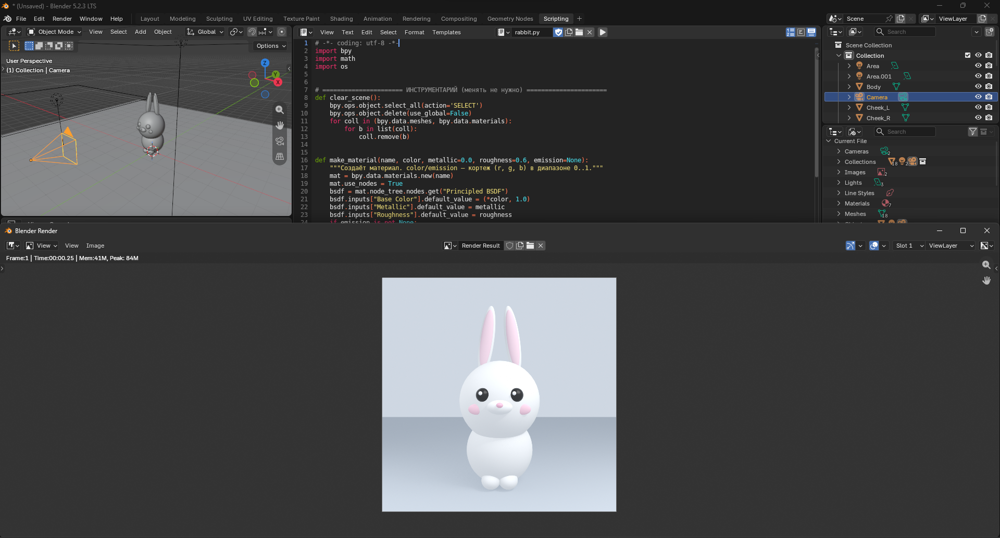
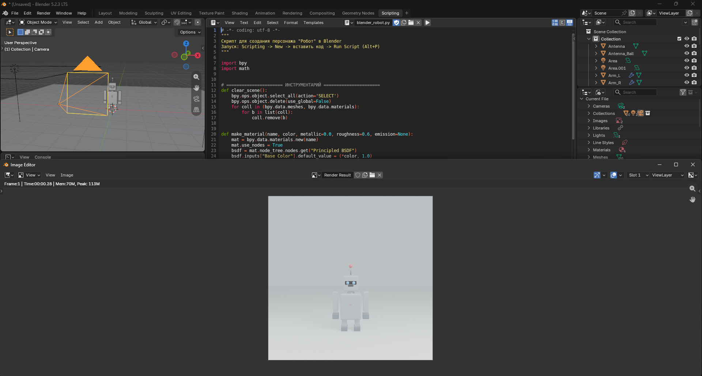

# VR-Models

Коллекция 3D-персонажей, собранных из примитивов **Blender** средствами **Python (bpy)**.
Каждый персонаж — это один скрипт: он очищает сцену, строит модель из сфер, кубов,
цилиндров и конусов, настраивает свет и камеру и сохраняет готовый рендер.

---

## 🐰 Кролик — `rabbit.py`

| Параметр | Значение |
|---|---|
| Объектов в сцене | 17 |
| Примитивы | UV-сферы, эллипсоиды |
| Материалы | мех, розовый (уши, щёки, нос), чёрный (глаза), белый (блики) |
| Особенности | пропорции «чиби», большая голова, длинные уши с розовой внутренней частью, блики в глазах |
| Рендер | `Rabbit.png` |

---

## 🤖 Робот — `robot.py`

| Параметр | Значение |
|---|---|
| Объектов в сцене | 19 |
| Примитивы | кубы (со скруглением), цилиндры, сферы |
| Материалы | светлый металл, тёмный металл, чёрный, голубой, красный |
| Особенности | антенна, панель глаз со светящимися линзами, кнопки на корпусе |
| Рендер | `Robot.png` |
