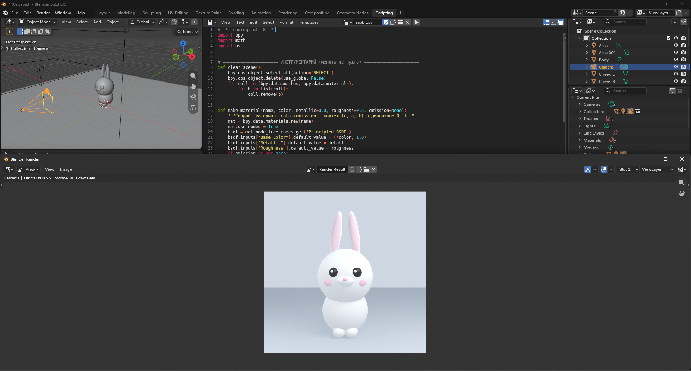
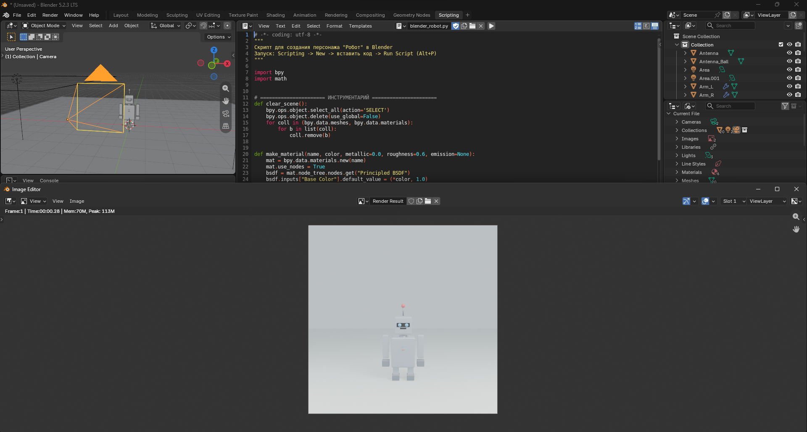

# VR-Models

Небольшая коллекция 3D-персонажей, созданных из примитивов в Blender с помощью Python API `bpy`: кролик и робот.

## Превью

### Кролик

Рендер: [Rabbit.png](Rabbit.png)

### Робот

Рендер: [Robot.png](Robot.png)

## Запуск

1. Откройте Blender и перейдите во вкладку **Scripting**.
2. Откройте `rabbit.py` или `robot.py` в редакторе текстов Blender.
3. Нажмите **Run Script** или `Alt+P`.

Скрипт создаёт сцену, модель, освещение и камеру. Для запуска нужен Blender; устанавливать `bpy` через `pip` не требуется.

## Файлы

| Файл | Назначение |
|---|---|
| `rabbit.py` | Модель кролика |
| `robot.py` | Модель робота |
| `Rabbit_screenshot.png`, `Robot_screenshot.png` | Скриншоты сцен |
| `Rabbit.png`, `Robot.png` | Рендеры |
